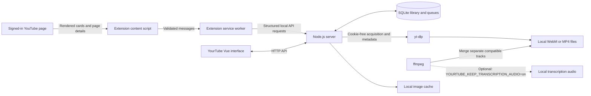

# YourTube architecture

This document describes the current implementation. It separates the shipped behavior from ideas that have only been discussed.

## System shape

The server and UI are one local application. `server.js` serves the HTML pages, the bundled Vue runtime, local images, media, and JSON APIs. It uses Node's built-in HTTP and SQLite modules; there is no external database service, framework server, or message broker.

## Responsibilities by file

| File | Responsibility |
| --- | --- |
| `server.js` | SQLite schema and migrations, API routes, feed/search results, downloads, playback history, retention, background metadata work, local media/image serving. |
| `extension/capture.js` | Reads rendered YouTube cards, durations, subscriptions, playlist/Mix structures, channel details, and page-visible video/comment data. Expands supported “Show more” controls and scrolls tracked channel sections. |
| `extension/background.js` | Sends captured records, manages browser-side sync retries, reflects Online/Offline state, sequences channel captures, and runs browser-page metadata captures. |
| `extension/bridge.js` | Relays requests from the YourTube page to the extension, including search and channel-capture requests. |
| `extension/popup.*` | Extension diagnostics for server/mode connectivity, browser capture tabs, local sync retries, queue samples, and recent failures; also controls Online/Offline mode. |
| `public/index.html` | Vue-based home, search, channel, playlist, history, downloads, and background-status views. |
| `public/player.html` | Local watch page, comments, playlist and Up next panels, plus the downloads-in-progress view. |
| `scripts/backfill-video-durations.js` | Explicit sequential duration backfill that can be paused by Offline mode. |
| `public/vendor/` | Bundled Vue runtime and its MIT license, so the application UI does not depend on a CDN. |

## Data and identity

YouTube's 11-character video ID is the stable local identity. Repeated captures update the existing `videos` row instead of duplicating a card. Important tables include:

- `videos`, `video_provisions`, and `video_provenance`: canonical stub metadata, broad provision categories, and a separate source history with source type/key/label/URL, first/last observation times, and observation count.
- `subscriptions`, `channels`, `channel_items`, and `channel_captures`: subscription presentation and captured channel profiles, tabs, items, and progress.
- `playlists`, `playlist_items`, and `playback_queue`: local playlists, read-only YouTube playlist/Mix imports, and the play-next queue.
- `downloads` and `download_retry_queue`: acquisition state, progress, retry schedule, pause reason, and acquisition/expiry timestamps.
- `transcription_assets`: optional retained audio derivatives, source/audio checksums, transcription status, and fields for future transcript text, segments, model, and language.
- `video_metadata`, `download_metadata`, `video_comments`, `cached_images`, and `video_thumbnail_assets`: saved metadata, completeness work, capped comment data, cached image indexes, and the first locally stored thumbnail linked by video ID.
- `video_views`, `video_progress`, `search_history`, `search_history_results`, and `search_history_clicks`: aggregate opens, latest resume position, search sessions, and clicked results.
- `video_duration_lookups` and `extension_duration_baseline`: duration work state and per-extension-version duration coverage observations.
- `app_settings`: persistent Online/Offline, auto-delete, protection-cooldown, and preparation settings.

The database and image cache live under `data/` unless `YOURTUBE_DATA_DIR` points elsewhere. Media is in `data/media/` unless `YOURTUBE_MEDIA_DIR` selects a separate folder or mounted drive. Transcript-ready audio retention is off by default. When explicitly enabled with `YOURTUBE_KEEP_TRANSCRIPTION_AUDIO=on`, 16 kHz mono FLAC files are stored separately in `data/transcription-audio/`, never mixed with normal or Shorts media. Media is WebM where available; finite videos can use a compatible MP4 fallback. The server watches the selected directory and rescans it periodically. It imports stable ID-named files after an integrity check, creates a minimal stub for an otherwise unknown valid YouTube ID, and marks removed media as needing reacquisition while retaining metadata. These folders contain personal data and may contain many gigabytes of media; they are deliberately ignored by Git.

## Capture and search flows

### Homepage and normal browsing

The extension observes rendered YouTube DOM rather than copying the whole page. It identifies video cards and their rendered titles, channel names, thumbnails, avatars, duration badges, section/topic labels, and source. It filters likely sponsored cards, Playables, YouTube movie listings, explicitly paid/member-only cards, and cards with the generic title `Watch`. Confirmed movie-listing or paid-content items enter `acquisition_exclusions`; their active stubs, queue references, and local media are removed, while their metadata is retained in `excluded_acquisition_metadata`. Later syncs reject those IDs. Permanently unavailable live recordings remain as metadata stubs with a non-retrying unavailable status. Feed cards are sent to `/api/sync`; the server records broad categories in `video_provisions`, detailed source context in `video_provenance`, and merges canonical records by video ID.

The homepage is a view over accumulated stubs, not a second remote YouTube request. The server returns recent observations; the UI sorts downloaded items by acquisition time and can shuffle undownloaded items on refresh. Cards expose source and “pulled” age. Section membership is best-effort because it depends on the current YouTube DOM. The current shuffle does not weight undownloaded items by acquisition recency.

### Search

Typing starts a local query immediately. In **YouTube** mode the first results are matching, not-yet-downloaded stubs already in SQLite; after one second without further input, the app asks the extension to open a background YouTube results page. The extension sends rendered results to the server as they appear, and the UI polls the session to add them while collection continues. Results are retained locally; scrolling to the end asks for another batch of 12, without a separate Show more control. Downloaded files are excluded from this mode and are represented by a local-results shortcut/count. **Local** mode searches only media downloaded to this server. Search results and search selection are persisted so Up next can use unclicked results.

### Channels and playlists

Opening a channel shows stored channel data immediately and asks the extension to prefetch its Home, Videos, Shorts, Live, Playlists, and Community tabs. Channel captures are serialized through one channel tab; priority content is sent first and remaining scrolling capture continues in the background. Capture records include the exact channel and tab for provenance.

One shared extension adapter recognizes YouTube playlist and Mix records from homepage, search, channel playlist tabs, and an open playlist page. It normalizes `/playlist?list=…` and `/watch?list=…` links, preserves Mix identity, and sends every captured record through the same asynchronous sync queue. Opening an incomplete YouTube playlist in YourTube asks the extension to open one inactive YouTube tab, scroll its playlist container, and sync entries as they load. The local detail view polls the playlist record, so entries appear without a manual refresh. The extension closes its capture tab after the final sync is acknowledged or queued. When the app returns Online, open YouTube tabs recapture their rendered data. Playlist-page entries come only from the playlist container, not unrelated watch recommendations; unloaded entries remain marked as incomplete. Imports are read-only with respect to the YouTube account. Local playlists support create/rename, add/remove, reordering, Watch later, shuffle, queueing, and sequential playback. Playlist entries point at local stubs; acquisition begins when a user starts playback.

### Browser metadata capture

When `yt-dlp` cannot return a video length or browser-visible details are needed, the server marks the lookup for extension capture. The extension opens an inactive signed-in YouTube watch page, reads rendered fields, and sends structured metadata to localhost. Source version **0.5.39** supports one to five configurable concurrent video-length capture tabs, with a pause control that stops new tabs while existing tabs continue. It filters YouTube movie and explicit paid/member-only card markers, while server-confirmed paid items are suppressed from future syncs. Permanently unavailable live recordings retain their metadata stubs and stop retrying. It tolerates YouTube URL rewrites, waits up to ten minutes for user-resolved CAPTCHA or age verification, then closes the tab and retries if no duration arrived. The extension popup exposes capture state and recent events, probes localhost directly if its worker is unavailable, and distinguishes a stale worker from a server outage. Its diagnostics endpoint accepts extension-origin or originless loopback requests. On extension updates, the worker reloads open YourTube tabs that are not playing audio, so Chrome drops invalidated bridge contexts and injects the current bridge without interrupting active playback.

## Acquisition and playback

Selecting a stub opens the local watch route. The server runs `yt-dlp` with `--no-cookies`, `--no-playlist`, and a WebM-first format selection. For videos with a known finite duration, it can fall back to compatible MP4 streams if YouTube offers no WebM. Unknown-duration and live captures stay WebM-only so the existing partial-recording finalizer can safely save them. ffmpeg merges separate tracks when needed; the media endpoint serves the correct content type for either container. Progress is parsed from yt-dlp output and stored for the UI. A no-compatible-format response is paused as non-retryable instead of repeatedly issuing the same request. The player waits for the local file and presents explicit failure/retry states; there is no online-playback fallback.

At the save boundary, ffmpeg decodes the full audio/video to verify the media. Transcript-ready 16 kHz mono FLAC derivatives are optional and are disabled by default; set `YOURTUBE_KEEP_TRANSCRIPTION_AUDIO=on` to retain them, along with their checksums and `awaiting_transcription` status. Audio extraction errors do not invalidate otherwise verified playable media. Media-folder imports use the same integrity flow. Existing ready files are not bulk-processed; a later integrity pass creates an audio derivative only when retention is enabled. Turning retention off does not delete audio files already present.

Downloads run independently of watch-page polling while the Node process remains running. A persistent SQLite retry queue handles transient failures, exponential delay, and pause states. After ten failures an item is paused for user attention. Optional anti-throttling behavior is configurable; it is off by default. Live acquisition is identified separately; a captured playable file can be finalized and saved, or discarded.

The local player writes an aggregate view-start counter and a latest playback-progress snapshot. It saves progress during playback and on page exit, resumes incomplete clips, supports autoplay through playlists and Up next, and has theater/expanded and fullscreen layouts. The app shell routes between home, channel, downloads, and watch views while keeping one watch DOM root and its media element alive. On other views the router moves that same element into a draggable mini player, then restores it when the watch view returns. The mini player and watch view both read the SQLite `playback_queue`; queue entries are played ahead of automatic recommendations and removed after the local file is ready. Keyboard shortcuts include J/K/L, Space, number-key seeking, and F for fullscreen. The watch page includes comments and local recommendations. Comment snapshots are capped at 1,000 per video; YouTube may disable or withhold them.

## Metadata, Offline mode, and retention

Once a media download is ready, the downloaded-metadata queue checks its video details, duration, comments, thumbnail, channel avatar, and commenter avatars. It stores downloaded-video metadata and referenced images in the local database/cache. All API image fields are localized before YourTube renders them: a cache miss goes through `/api/remote-image`, which saves the bytes before serving them. The first successful video thumbnail is linked by ID in `video_thumbnail_assets`; subsequent syncs keep that asset canonical even if YouTube changes the source URL. Unsupported uncached external images fail closed to a placeholder. The status page exposes work by item and phase; failures remain visible and retry. Duration may come from rendered extension cards, a signed-in browser capture, yt-dlp metadata, or the actual local file/playback.

Switching Offline pauses discovery and new retry attempts. A normal transition first waits for active media transfers and the current local-metadata worker to settle, then prepares missing lengths, comments, thumbnails, channel avatars, and commenter avatars. An immediate option pauses preparation and resumes it the next time the app goes Online. Connectivity is checked before Online mode is accepted. If connectivity is lost while Online is the user's chosen mode, the server records that it forced Offline and automatically returns Online after connectivity is restored. An explicit user choice to remain Offline is persisted and prevents this automatic reconnect, including across server restarts. Offline search and Up next are limited to local material.

Auto-delete is a separate user-controlled 24-hour media-retention setting. Its deadline is persisted per ready file, can be paused/cleared by turning the setting off, and is checked again transactionally before a file is unlinked. Deleting a media file preserves its stub, metadata, and view history.

## Queue ownership and consistency

| Work | Persistent owner | Retry behavior |
| --- | --- | --- |
| Download acquisition | SQLite `download_retry_queue` | Server retries eligible work, pauses after ten failures, respects Offline mode and configured protections. |
| Extension sync delivery | `chrome.storage.local` | Browser retries captured payloads when localhost returns; it pauses while Offline. |
| Channel section capture | SQLite status rows plus extension queue/storage | One channel section tab at a time; opening/collecting/queued work with no progress for five minutes is finalized as stale and removed from the active queue view. |
| YouTube search capture | SQLite `search_sessions` and `search_results` | No-result-progress sessions are finalized as stale after five minutes; saved results remain available, and a late batch refreshes the session. |
| Video lengths | SQLite `video_duration_lookups` | Server attempts local/yt-dlp lookup and delegates eligible cases to browser capture; capped browser attempts and later retry state. |
| Downloaded metadata | SQLite `download_metadata` | One worker at a time; phase, attempts, and next retry are visible and durable. |
| Offline preparation | SQLite settings/checkpoint plus current server state | Ordered phases, resumable background work, explicit immediate-pause path. |

These queues use SQLite and Chrome's own extension storage. RabbitMQ was not introduced: this is a single-user local app with one Node process, and a separate broker would add another service and failure mode without helping the current deployment.

## Network boundaries

By default, the server binds only to `127.0.0.1`. The optional `0.0.0.0` bind is for a trusted LAN and does not add authentication. The extension talks to localhost. The downloader never receives the browser's session cookies. YouTube's DOM and access controls remain upstream dependencies; YourTube does not implement DRM bypass.
